# Touchline

**Tactical analytics from FC Mobile gameplay: player and ball detection, pitch homography and team-shape analysis from phone screen recordings.**

Touchline turns phone screen recordings of FC Mobile matches into tactical data. A fine-tuned YOLO detector finds players and the ball, a classical homography maps them onto a 105×68 m pitch, and kit-colour clustering splits the teams, so it can measure width, depth, defensive line and formation frame by frame.

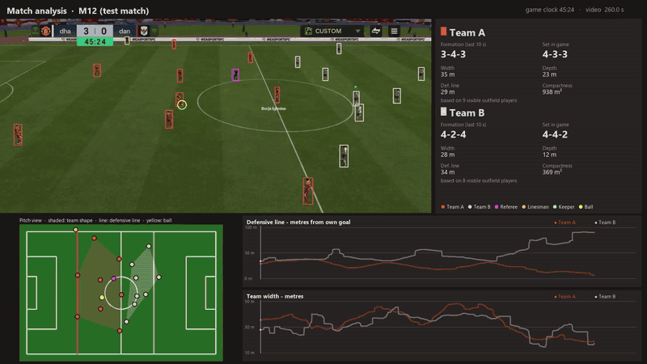

*Final demo on test match M12. Top left: the footage with team, referee, linesman and ball labels. Top right: each team's formation, width, depth, defensive line and compactness. Bottom left: a top-down pitch view. Bottom right: the defensive line and team width over time.*

<!-- Full-length demo videos: drag the MP4s into this README in GitHub's web editor (it hosts them as user-attachments) or add them to a Release, then link them here. -->

---

## Contents

1. [What this project does](#what-this-project-does)
2. [Results at a glance](#results-at-a-glance)
3. [Pipeline](#pipeline)
4. [Step 1: Choosing a camera angle](#step-1-choosing-a-camera-angle)
5. [Step 2: Dataset and EDA](#step-2-dataset-and-eda)
6. [Step 3: Training the detector](#step-3-training-the-detector)
7. [Step 4: Pitch homography](#step-4-pitch-homography)
8. [Step 5: Teams, roles, ball and pitch positions](#step-5-teams-roles-ball-and-pitch-positions)
9. [Step 6: Team shape and formation](#step-6-team-shape-and-formation)
10. [Repository layout](#repository-layout)
11. [Running it](#running-it)
12. [Limitations and next steps](#limitations-and-next-steps)
13. [Acknowledgements](#acknowledgements)

---

## What this project does

The input is a phone screen recording of an EA SPORTS FC Mobile match. The output is a top-down view of the match: every player and the ball placed on the pitch in metres, split into Team A, Team B, referee, linesmen and goalkeepers. From those positions it measures each team's width, depth, defensive line and compactness, and estimates their formation.

A video game is a controlled source for this. The broadcast-style camera, pitch and kits look much like real football, but there are no licensing or privacy problems and the true formation of each team is known, because it is set in the game before kickoff.

Everything after the detector is classical computer vision: line masks, Hough transforms, least squares, optical flow and colour clustering. The only learned model is a YOLO detector for people and the ball.

## Results at a glance

| Stage | Result |
|---|---|
| Detector (YOLO26x at 2400 px, held-out validation matches) | **mAP50 0.96**, mAP50-95 0.73; person precision/recall 0.99 / 0.995, ball 0.96 / 0.90 |
| Homography, single frame (vs 182 hand-clicked landmarks) | 21 / 22 live test frames correct; **median error 0.13 m**, 95th percentile 0.49 m |
| Homography, tracked through video | 22 / 22 test frames answered; **median 0.14 m**, worst 1.5 m; 0.34 s per frame |
| Team colour seeding at kickoff | worked on 17 of 18 matches |
| Ball position | present in 70–85 % of frames |
| Player speeds after mapping to the pitch | all ≤ 9 m/s over 1 s (physically plausible) |
| Formation vs the formation set in game | 3 / 6 correct while defending |

## Pipeline

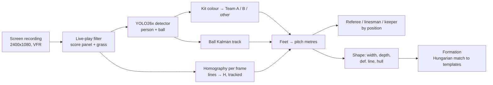

---

## Step 1: Choosing a camera angle

FC Mobile offers five in-game camera angles. All five were recorded (28 situation clips plus full matches) and scored for player coverage, camera movement, ball visibility, pitch geometry and resolution.

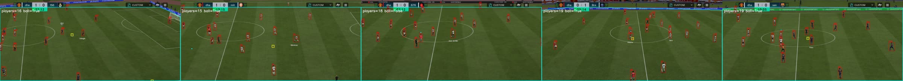
*Cameras 1–5 at kickoff, left to right.*

The weighted score was `S = 0.30·Coverage + 0.25·Geometry + 0.20·Movement + 0.15·Ball + 0.10·Resolution`. An automatic benchmark (`benchmark/camera_benchmark.py`) then measured all five on equal footage with a COCO YOLO model. Its key numbers for one full match per angle:

| Camera | Player visibility rate | Players per frame | Ball visibility rate | Zoom rate |
|---|---|---|---|---|
| 1 | **0.845** | 18.9 | **0.775** | **0.026** |
| 2 | 0.791 | 17.6 | 0.731 | 0.043 |
| 3 | 0.734 | 16.3 | 0.736 | 0.067 |
| 4 | 0.821 | 18.6 | 0.749 | 0.080 |
| 5 | 0.759 | 17.0 | 0.749 | 0.042 |

**Camera 4 was chosen.** Its coverage is statistically tied with Camera 1 (overlapping bootstrap intervals), it keeps track IDs longest (median track 10.7 s at kickoff vs 3.9–5.1 s for the rest), and the final recordings were already on Camera 4. All benchmark tables are in [`benchmark/results/tables.md`](benchmark/results/tables.md).

## Step 2: Dataset and EDA

**20 full matches** were recorded on Camera 4. They are split **by whole match** so that no test frame shares a match with a training frame ([`dataset/splits.csv`](dataset/splits.csv)):

| Split | Matches |
|---|---|
| Train | 14 matches |
| Validation | M03, M08, M17 |
| Test | M04, M11, M12 |

An EDA pass over every recording ([`eda/video_eda.py`](eda/video_eda.py) → [`eda/tables/`](eda/tables/)) looked at container metadata, frame timing, image statistics and COCO detections. What it found shaped everything after it:

- **Variable frame rate.** Mean fps ranged from 17.6 to 36.4, with bursts to about 63 and 7–22 freezes longer than 0.5 s per file. Frames are therefore sampled by timestamp, never by frame index.
- **About two-thirds live play.** The rest is replays, cutscenes and menus. Replays are recognised by the missing score panel in the top-left corner.
- **Small objects.** On-pitch players have a median box height of about 74 px, and the ball is about 13 px. This is why the detector is trained at the full 2400 px width.

The per-video sampling plan takes train frames from 5 s windows with a quota (50 % random, 20 % fast pan, 20 % ball missed, 10 % near the frame edge) and val/test frames uniformly every 6 s.

## Step 3: Training the detector

Frames were labelled in a loop: sample → pre-label with the current model → correct by hand in Roboflow → train. The loop was run with **Kitman**, a separate Flask tool built for this project that is kept in its own repository. In total 1,350 frames were sent for labelling across 5 batches. The final set is **562 train + 238 validation** frames.

| Run | Model | Input px | Classes | Train / val frames | Precision | Recall | mAP50 | mAP50-95 |
|---|---|---|---|---|---|---|---|---|
| 1 | YOLO26s | 1280 | 4 roles | 54 / 54\* | 0.89 | 0.89 | 0.88 | 0.72 |
| 2 | YOLO26m | 1920 | 4 roles | 54 / 54\* | 0.97 | 0.95 | 0.97 | 0.85 |
| 3 | YOLO26s | 2400 | 4 roles | 300 / 261 | 0.78 | 0.83 | 0.84 | 0.66 |
| 4 | YOLO26m | 2400 | person + ball | 303 / 261 | 0.94 | 0.93 | 0.94 | 0.70 |
| **5** | **YOLO26x** | **2400** | **person + ball** | **562 / 238** | **0.98** | **0.95** | **0.96** | **0.73** |

\* Runs 1–2 were validated on their own training frames, so their scores are optimistic and can't be compared with the later runs.

**Why only person + ball?** Run 3 tried four role classes (player, goalkeeper, referee, ball) and mistook dark-kit players for referees: referee precision was 0.48. Kit colours change every match, and 14 matches aren't enough for a detector to learn that. So the detector only finds people and the ball, and roles are assigned later from kit colour and pitch position.

| Precision–recall curve (run 5) | Confusion matrix (run 5) |
|---|---|
| 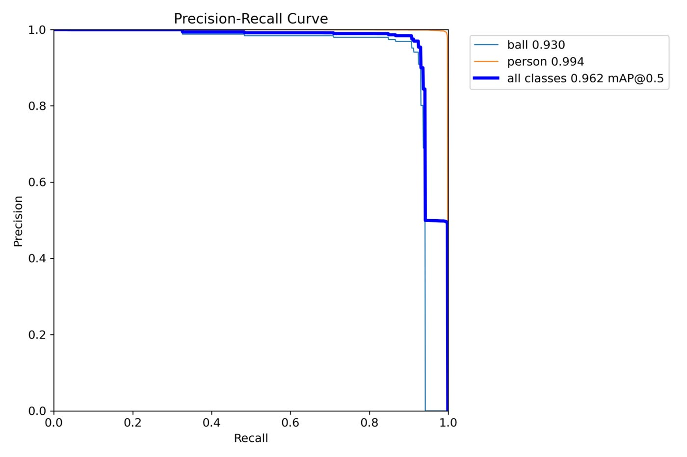 | 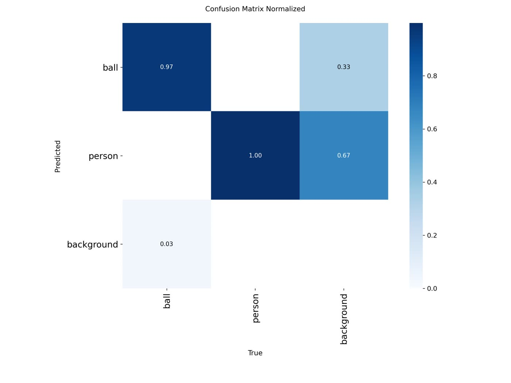 |

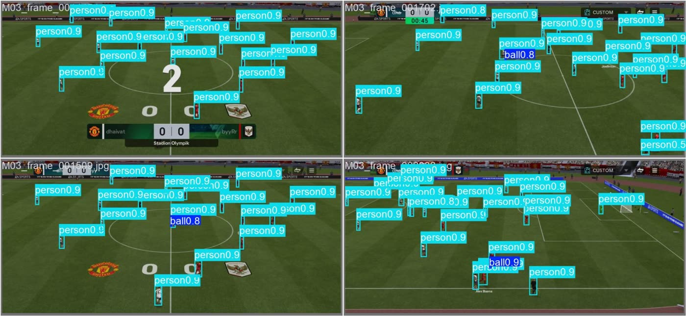
*Run 5 predictions on held-out validation frames.*

| Class | Precision | Recall | mAP50 | mAP50-95 |
|---|---|---|---|---|
| person | 0.992 | 0.995 | 0.994 | 0.889 |
| ball | 0.963 | 0.904 | 0.926 | 0.578 |

People are essentially solved. The ball is the hard class: it is about 13 px wide, blurred in fast play and often hidden by players.

## Step 4: Pitch homography

A homography **H** is a 3×3 matrix that maps the flat pitch (in metres) to the image (in pixels). Its inverse turns a player's feet in pixels into a position on the pitch. The camera pans and zooms all the time, so **every frame needs its own H**. This step uses no training data: only white-line masks, Hough lines, ellipse fits and least squares.

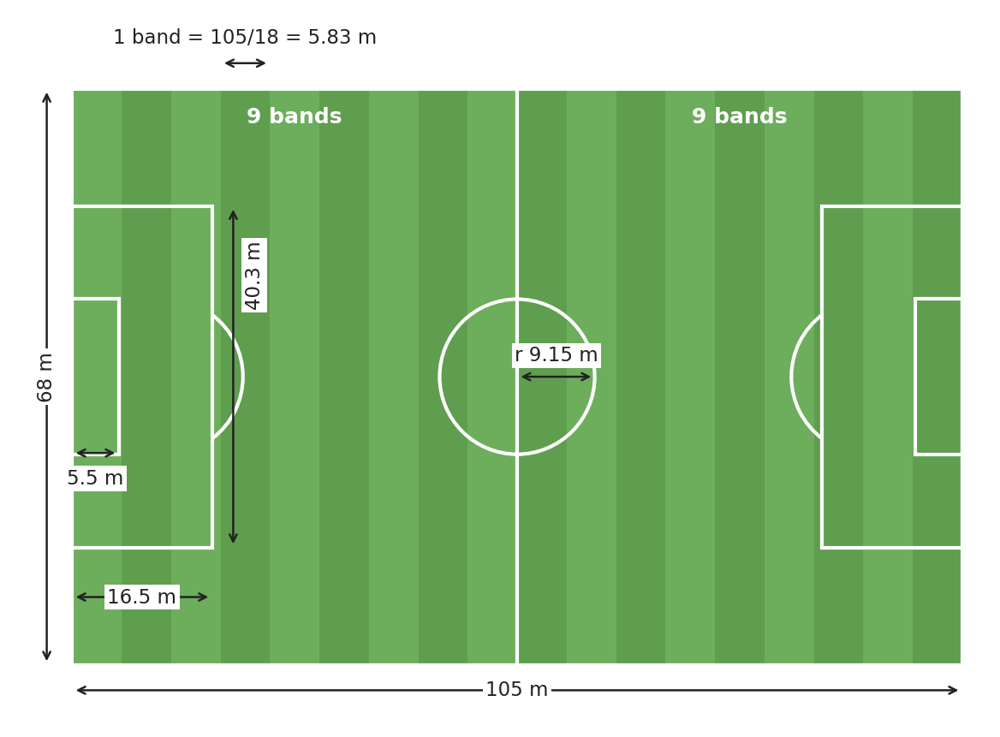

**Measuring the pitch.** A joint least-squares fit over four frames solved each frame's H together with a shared pitch length and width. It gave **105.6 m × 68.3 m**, so the standard 105 × 68 m is used. The grass has **18 mowing bands** of 105/18 = 5.83 m each, and those band edges help pin down distance along the pitch when few lines are visible.

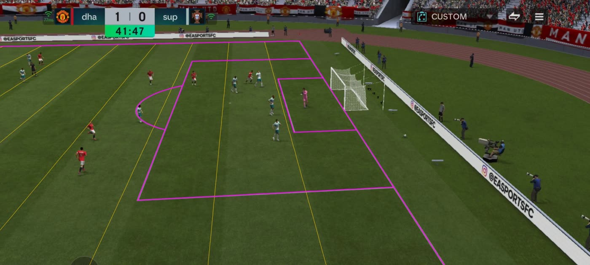
*The fitted pitch model (magenta) drawn over a frame.*

**Automatic labeller** ([`homography/autolabel.py`](homography/autolabel.py)):

1. Mask the grass, then find white line pixels with a saturation cut relative to the grass.
2. Turn Hough segments into lines (flat lines = touchline family, steep lines = goal-line family) and fit ellipses to the leftover arcs.
3. Build hypotheses: near a goal, 2 steep + 2 flat lines solved by line DLT; in midfield, the touchline, halfway line and centre circle.
4. Score each hypothesis by how many model points land on white pixels minus half of those that land on grass.
5. Refine the best 6 with a least-squares fit over all lines. A frame counts as OK if at least 60 % of the model lands on white.

Result: **154 of 179** check frames fitted. About half of the failures were correct rejections (goal cards, line-ups, stadium flyovers).

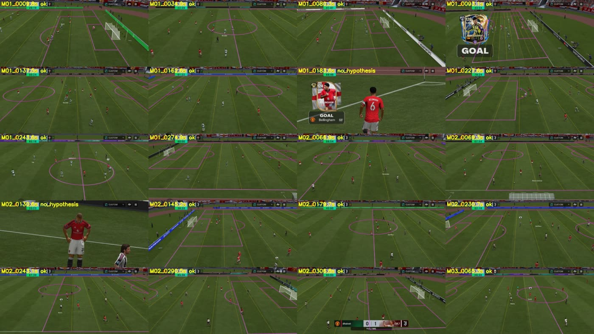
*Contact sheet of check frames with the fitted pitch model drawn on.*

**Ground truth.** 182 landmarks were hand-clicked on 26 frames from the test matches with [`homography/click_gt.py`](homography/click_gt.py). Errors are measured on the pitch in metres:

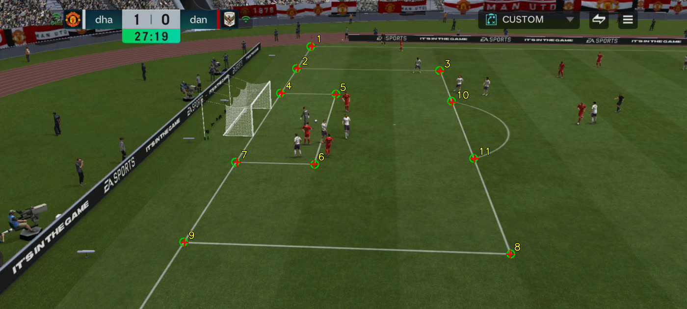

| Single-frame labeller | Tracked through video |
|---|---|
| 21 / 22 live frames correct | 22 / 22 frames answered |
| median **0.13 m**, p95 0.49 m | median **0.14 m**, worst 1.5 m |
| 1–25 s per frame | **0.34 s per frame** |

**Tracking** ([`homography/track.py`](homography/track.py)) makes this fast enough for whole videos. Optical flow on the grass predicts the camera motion, the prediction is snapped onto the pitch lines (12 px search, then 6 px), and the full labeller only runs again when line support falls below 0.6. Because it refines on the real lines every frame, it does not drift.

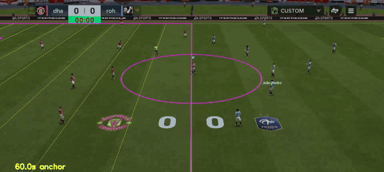
*The pitch model tracked frame by frame through test match M11.*

## Step 5: Teams, roles, ball and pitch positions

**Teams from kit colour** ([`roles/roles.py`](roles/roles.py)). Kit colours change every match, so the two teams are learned per match at kickoff, when the halfway line separates them:

- **Shirt colour:** the median Lab colour of the shirt area, with pixels close to the grass colour removed, so green kits still work.
- **Seeding:** one median colour per half at kickoff, refined by 2-means and ignoring people far from both colours (the referee).
- **Assignment:** each person gets the nearest team colour, or "other" if their colour is too far from both.
- **Smoothing:** ByteTrack IDs plus a majority vote over ±15 frames, which tolerates ID swaps.

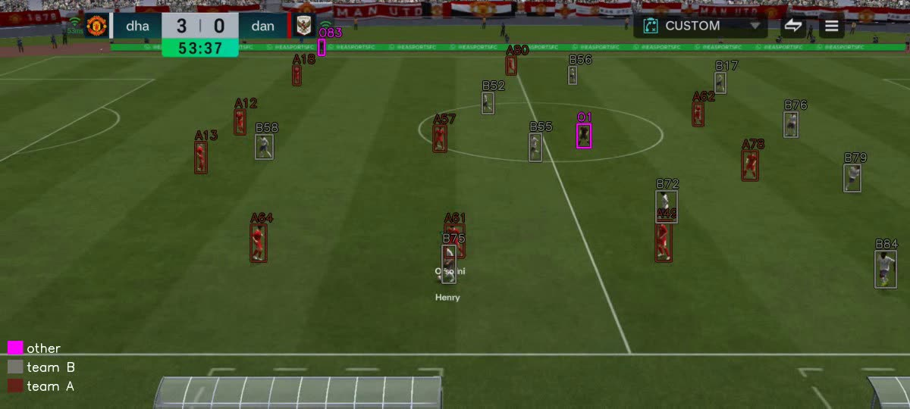

**Referee, linesman, goalkeeper by position** ([`roles/pitch.py`](roles/pitch.py)). Everyone in the "other" group is mapped to the pitch, and the median position of each track decides the role: within 4 m of a touchline → linesman, inside a penalty box (+2 m) → goalkeeper, anywhere else → referee.

**Ball** ([`roles/ball.py`](roles/ball.py)). A constant-velocity Kalman filter on the ball's ground point keeps one ball per frame. Its gate widens while the ball is missing, short gaps are interpolated, and short false tracks (white boots, the centre spot) are dropped.

**Pitch positions.** Each person's feet go through the nearest homography in time to give pitch coordinates in metres.

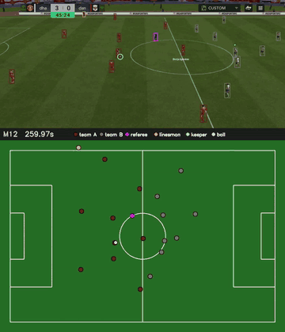
*Players and ball on the pitch, M12.*

## Step 6: Team shape and formation

[`roles/shape.py`](roles/shape.py) measures each team per frame, using outfield players only and metres oriented by attack direction:

| Measure | How it is calculated |
|---|---|
| Width | spread across the pitch, 90th − 10th percentile |
| Depth | spread along the pitch, 90th − 10th percentile |
| Defensive line | mean of the two deepest players, in metres from own goal |
| Compactness | area of the convex hull of visible players |
| Formation | positions standardised, then matched to 9 templates (4-4-2, 4-3-3, 4-2-3-1 …) with the Hungarian algorithm; majority vote over the stretch |

The attack direction comes from the offside line: the defending team's deepest outfield player is nearer its own goal. The half is read from the HUD clock with digit templates ([`roles/clock.py`](roles/clock.py)).

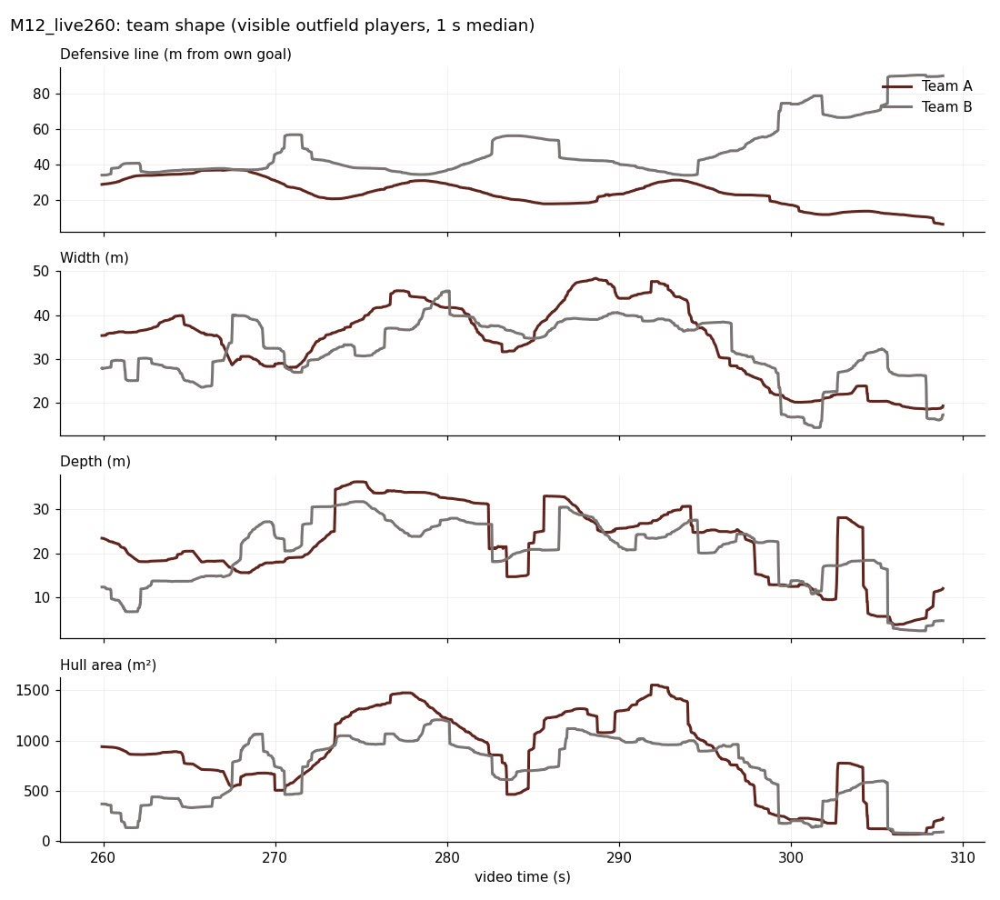

**Formation vs ground truth.** The true formations are set in the game before each match ([`dataset/formations.csv`](dataset/formations.csv)):

| Match | Team | Set in game | Detected (while defending) |
|---|---|---|---|
| M04 | user | 4-2-3-1 | 4-2-3-1 ✅ |
| M04 | opponent | 4-3-3 | 4-3-3 ✅ |
| M11 | user | 4-3-3 | 4-3-3 ✅ |
| M11 | opponent | 4-2-4 | 4-2-3-1 ❌ |
| M12 | user | 4-3-3 | 4-4-2 ❌ |
| M12 | opponent | 4-4-2 | 4-2-4 ❌ |

That is **3 / 6 correct while defending** (2 / 6 over all frames). Teams keep their shape best when defending; in attack, players push forward and the template match gets less reliable.

---

## Repository layout

```
.
├── train_yolo26s.ipynb                      training notebook (Kaggle)
├── benchmark/        camera-angle benchmark + result tables
├── dataset/          match split, formations ground truth, frame sampler, sampling plan
├── eda/              video EDA, summary tables, dashboard
├── homography/       pitch fitter, auto labeller, tracker, ground-truth tool + evaluation
├── roles/            teams, roles, ball, pitch mapping, shape/formation, demo video
└── docs/media/       images and GIFs used in this README
```

**Not in this repository:** the screen recordings (~48 GB), sampled and labelled frames, model weights, rendered videos and the Kitman labelling tool. Game footage belongs to EA, so it isn't redistributed.

## Running it

Tested with Python 3.10, Ultralytics 8.4, PyTorch 2.11 (CUDA) and FFmpeg on PATH.

```bash
pip install -r requirements.txt
```

Each script's usage is in its docstring. The main entry points:

```bash
python benchmark/camera_benchmark.py          # camera-angle benchmark
python eda/video_eda.py                       # EDA pass over the recordings
python homography/run_autolabel.py            # labeller on the check frames
python homography/track.py M11 60 30          # homography for 30 s of M11 from 60 s
python homography/eval_gt.py                  # score against clicked ground truth
python roles/run_roles.py live M12 260 55     # detect + track + teams for a stretch
python roles/pitch.py M12 260 55              # players -> pitch metres + minimap
python roles/shape.py M12 260                 # team shape and formation
python roles/demo.py M12 260 55               # final demo video
```

The recordings are expected in `Screen Recordings/`, and `roles/run_roles.py` loads the trained detector from Kitman's run folder. Edit the `SAMPLED` and `WEIGHTS` paths at the top of that file to point at your own copies.

Self-checks: `python homography/test_fit_lines.py`, `python homography/test_autolabel.py`, `python homography/test_eval_gt.py` and `python roles/test_roles.py`.

## Limitations and next steps

- **Formation** is right only half the time. Per-player averaged positions need stable IDs, and ByteTrack makes many new IDs at the low confidence threshold used.
- **Midfield homography** is the weakest case (up to 1.5 m error). Using the mowing bands as an extra term in the fit should help.
- **Goalkeepers** aren't assigned to a team yet, and a referee standing in the box at a corner is read as a goalkeeper.
- **Possession** and **Voronoi / pitch control** are natural next steps on top of the pitch positions.
- The data comes from one phone (2400×1080). Other resolutions need the fixed-pixel score-panel test rechecked.

## Acknowledgements

- [Ultralytics YOLO](https://docs.ultralytics.com) (YOLO11, YOLO26) for detection and ByteTrack.
- [Roboflow](https://roboflow.com) for annotation.
- EA SPORTS FC Mobile as the footage source. This is an independent personal project with no affiliation to EA.
